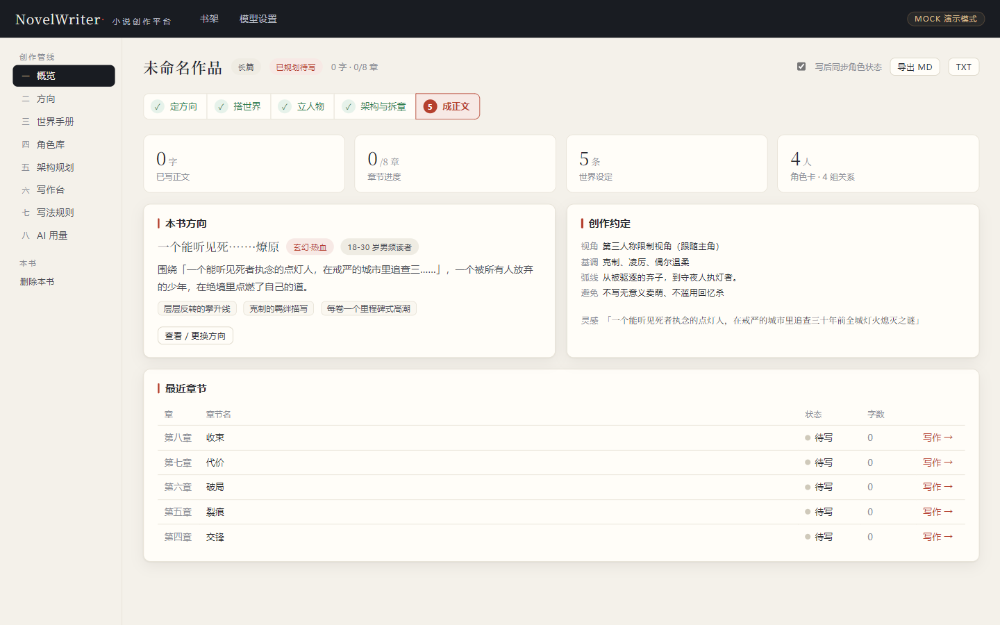
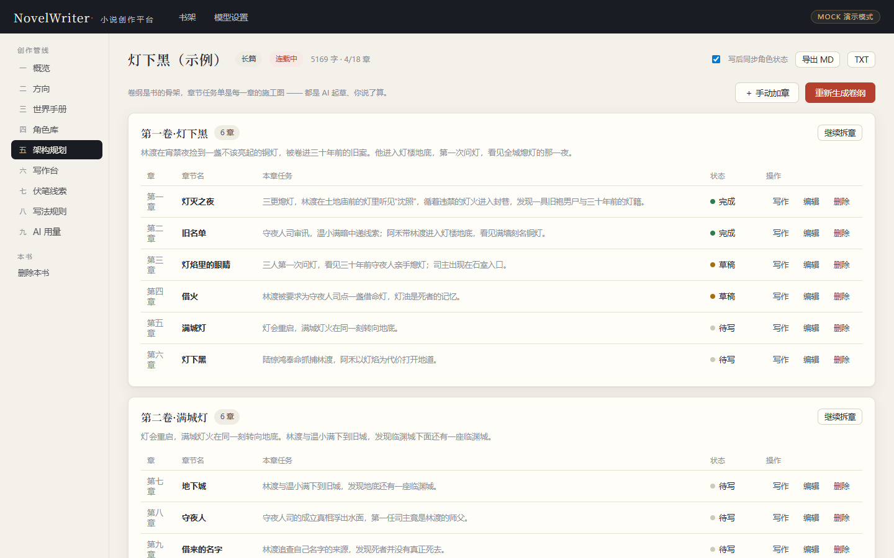
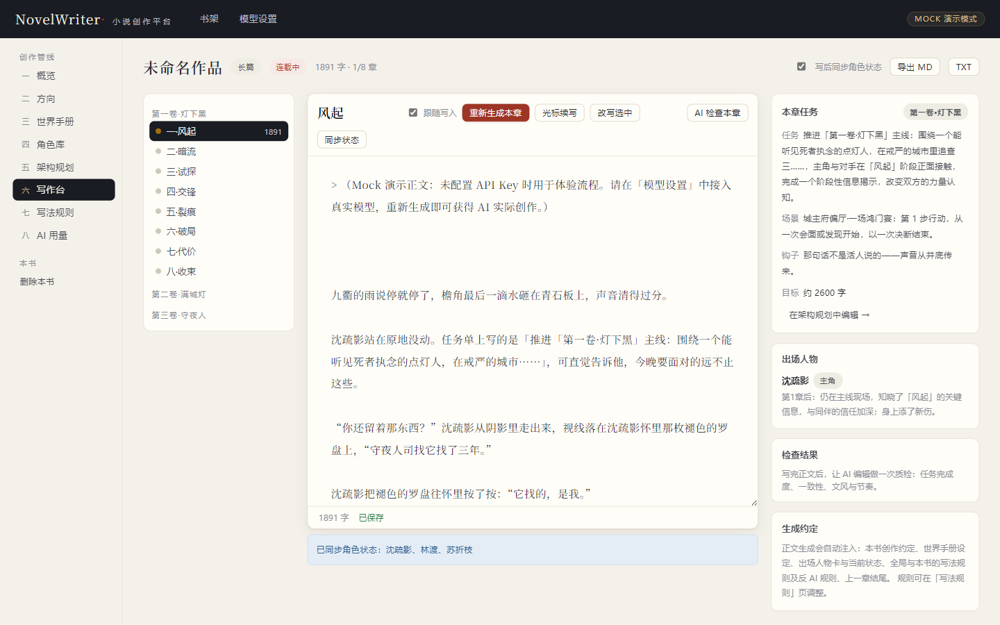
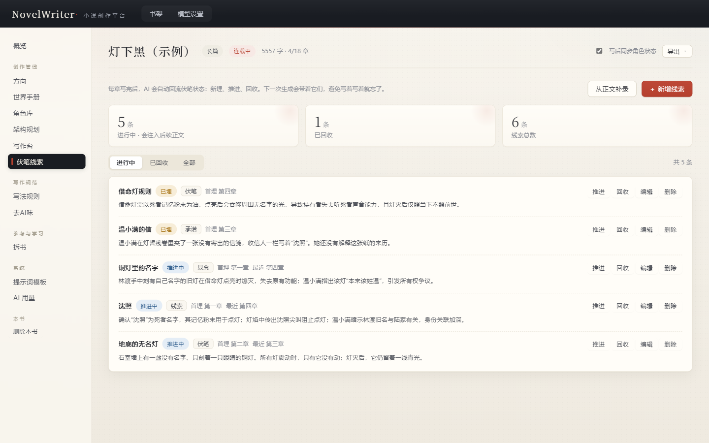

# NovelWriter · 小说创作平台

> 人管控、AI 管写 —— 从一句灵感，到一本有骨架、有世界、有正文的书。

NovelWriter 是一个**本地运行、自带 Key** 的 AI 小说创作平台。它把「方向 → 世界 → 角色 → 卷纲 → 拆章 → 正文 → 质检 → 记忆同步」做成一条可回滚的流水线：每个环节都能 AI 起草、人工修改，只有你确认的内容才会进入作品。

- **双协议模型接入**：Anthropic Claude 官方 Messages API + OpenAI 兼容接口（DeepSeek / Kimi / GLM / Qwen / SiliconFlow / OpenAI…），规划、正文、审阅可分别路由模型。
- **数据完全本地**：作品、配置、调用记录都在本机 SQLite（`server/data/novelwriter.db`），API Key 不出本机，无账号体系、无云同步。
- **零成本体验**：不配置 Key 也能用 Mock 演示模式或内置示例书跑通全流程。



## 目录

- [核心特性](#核心特性)
- [功能总览](#功能总览)
- [界面预览](#界面预览)
- [快速开始](#快速开始)
- [模型配置](#模型配置)
- [第一次使用建议路径](#第一次使用建议路径)
- [目录结构](#目录结构)
- [API 一览](#api-一览)
- [数据与配置](#数据与配置)
- [测试](#测试)
- [设计细节](#设计细节)
- [常见问题](#常见问题)
- [License](#license)

## 核心特性

- **积木式架构**：先把骨架搭稳——方向、世界、人物、卷纲、章节任务单，每块积木都可 AI 起草、人工修改，再进入正文。
- **人管控、AI 管写**：生成内容先进入预览，可采纳、可放弃；「跟随写入」可关；写作台支持流式生成、光标续写、选中改写，自动保存有防抖与版本兜底。
- **上下文即记忆**：生成时自动注入创作约定、世界设定、出场人物与**当前状态**、最近章节摘要、进行中的伏笔、既定事实、写法规则与反 AI 规则、上一章结尾，并按本章任务做全文检索召回——写得越长，记得越牢。
- **写完就体检，改完再复检**：AI 责编给出分级问题清单，可一键「按意见修文」——结果先进入预览，确认后才替换正文并自动留档；去AI味引擎做词表、统计、模型三层检测，命中处可直接让 AI 改写；批量连写低于分数线会自动修文一次。
- **上下文可核对**：写作台能查看本章实际注入的提示词内容与体量（世界设定、人物状态、规则、线索、事实、摘要、检索召回、上一章结尾），写到哪、AI 记得什么，一目了然。
- **参考与学习**：拆书可把喜欢的作品拆成结构模型、人物弧线、写法技巧，并一键写入本书写法库；提示词模板可按步骤覆盖，方便调教出稳定文风。
- **可回溯**：每章保留最近 80 个版本，生成、保存、回滚、批量都会留档；回滚前先为当前正文存档。

## 功能总览

| 模块 | 说明 |
| --- | --- |
| 书架与开书向导 | 一句灵感 → AI 生成 3 个差异明显的候选方向（题材 / 卖点 / 人设 / 约定）→ 选定建书；支持长篇与短篇（3 千 ~ 3 万字） |
| 方向与创作约定 | 题材、卖点、主角、基调、视角、故事弧线、禁忌；选定后成为全书约定，注入后续每次生成 |
| 世界手册 | 地理 / 势力 / 规则 / 物品 / 历史五类设定，AI 起草自动去重，人工可增改；底部汇总写后抽取的「已确立的事实」 |
| 角色库 | 角色卡（欲望 / 缺陷 / 外貌 / **当前状态**）+ 关系网；每章写完自动同步角色处境 |
| 架构规划 | AI 卷纲（阶段目标 / 冲突 / 钩子）→ 逐卷拆章（任务 / 场景 / 出场人物 / 章末钩子），全部可编辑 |
| 写作台 | SSE 流式整章生成、光标续写、选中改写；防抖自动保存；生成可预览后采纳；可查看本章上下文与提示词体量 |
| AI 责编 | 任务完成度、一致性、文风、节奏四维检查，问题按严重度分级并给出修改建议；可一键按意见修文，先预览再采纳 |
| 去AI味 | 30 条默认 AI 腔词表 + 平均句长 / 句首复读等统计特征 + 可选模型评分；正文高亮命中，逐句 AI 改写；阈值可调 |
| 故事记忆 | 每章写完一次调用产出「80–120 字摘要 + 角色状态 + 伏笔线索 + 既定事实」，后续章节自动带上 |
| 伏笔线索 | 写后自动回流「新埋 / 推进 / 回收 / 放弃」，也可人工维护或从已有正文补录；进行中的线索会注入下一次生成 |
| 全文检索 | SQLite FTS5（trigram，适合中文），不可用时自动降级 LIKE；概览页可手动检索，生成时按任务召回相关资料 |
| 版本历史 | 每章最近 80 个版本，可预览、手动存档、回滚；回滚前先为当前正文留档；生成 / 批量 / 修文等关键节点自动留档 |
| 批量连写 | 选定章节范围连续「生成 → 保存 → 写后整理 → 检查」；检查低于 55 分自动修文一次；任务落库，可暂停 / 继续 / 取消，关掉页面仍在后台推进 |
| 拆书 | 导入参考作品，自动分章与统计，AI 输出结构模型、人物弧线、写法技巧与可注入的规则 |
| 写法引擎 | 全局与本书两级「写法资产」+「反 AI 规则」，启用即注入生成与修文；内置反 AI 规则包可一键补齐 |
| 提示词模板 | 14 个创作环节可覆盖系统提示词、追加本书专属要求；保存历史版本，可回滚或恢复默认 |
| 码字统计 | 每日字数、连续写作天数、最高单日与最近 14 天节奏图 |
| 模型设置 | Anthropic Claude 官方接口 / OpenAI 兼容接口 / Mock 演示模式；按任务路由、连接测试、拉取模型列表 |
| 用量与运行记录 | 按步骤 / 模型统计 tokens（含缓存命中）、耗时、状态与错误，每次调用留痕可追溯 |
| 导出 | 整书导出 Markdown / TXT，或打包 Word（.docx）/ EPUB |
| 示例作品 | 书架一键载入《灯下黑》：3 卷 18 章骨架、3 章正文、5 条伏笔、版本历史与码字统计，零模型调用 |

**Mock 演示模式**：未配置 Key 时，内置演示引擎会生成结构化示例内容（正文会标注「Mock 演示」），零成本体验「方向 → 世界 → 角色 → 卷纲 → 拆章 → 正文 → 检查 → 写后整理 → 批量连写 → 导出」的完整创作链。

**内置示例作品**：不想从零开始，可在书架点「载入示例作品」，直接得到一本可读、可改、可回滚的《灯下黑》。它包含 3 卷 18 章、3 章完整正文、5 条线索、版本历史、近一周码字记录与调用记录，不调用任何模型。

## 界面预览

| 书架 | 架构规划 |
| --- | --- |
|  |  |
| **写作台 · 流式生成** | **伏笔线索** |
|  |  |

## 快速开始

### 环境要求

- **Node.js ≥ 22.5**（推荐 24 LTS）。服务端使用 Node 内置的 `node:sqlite`，Node 20 及更早版本不可用。
- npm（随 Node 安装）与任意现代浏览器。

### 开发模式

```bash
npm install                  # 根目录：开发脚本依赖
npm --prefix server install  # Express 服务端
npm --prefix client install  # Vite + React 前端

npm run dev                  # 同时启动服务端 :4680 + 前端 Vite :5700
```

打开 `http://localhost:5700`。开发模式下 Vite 会把 `/api` 代理到 `127.0.0.1:4680`。

### 生产模式

服务端直接托管前端构建产物，只开一个端口：

```bash
npm run build    # 构建 client/dist
npm start        # 打开 http://127.0.0.1:4680
```

### 环境变量

| 变量 | 默认值 | 说明 |
| --- | --- | --- |
| `PORT` | `4680` | 服务端端口（生产模式；开发模式改了端口需同步 `client/vite.config.ts` 的代理） |
| `HOST` | `127.0.0.1` | 监听地址；默认只允许本机访问 |
| `NW_HOME` | `server/` | 数据根目录，数据库放在其下 `data/` |
| `NW_DB_PATH` | `$NW_HOME/data/novelwriter.db` | 直接指定 SQLite 文件路径（测试用） |

## 模型配置

打开「设置 → AI 模型」，选择一种接入方式：

### 1. Anthropic Claude（官方直连）

- 服务商选 **Anthropic Claude**，地址自动填 `https://api.anthropic.com/v1`，填入 Anthropic 控制台创建的 API Key。
- 内置预设模型：`claude-sonnet-5-5`、`claude-opus-5-5`、`claude-haiku-5-5`；点「获取模型列表」可拉取账号实际可用的模型，下拉里没有的选「自定义模型…」手填。
- 服务端已适配官方 Messages API：`x-api-key` + `anthropic-version` 鉴权、`system` 独立字段、必填 `max_tokens`、流式 `text_delta`、缓存读写计入用量统计。
- 如果使用中转 / 聚合网关，请改选「OpenAI 兼容接口」并自行填写网关地址与 Claude 模型名。

### 2. OpenAI 兼容接口

- 预设 DeepSeek、Kimi、智谱 GLM、通义 Qwen、SiliconFlow、OpenAI，也可选「自定义」手填地址。
- 填 API 地址与 Key；「获取模型列表」会请求 `{baseUrl}/models`，失败时仍可直接手填模型名。

### 3. Mock 演示模式

无需任何 Key，所有 AI 步骤由内置演示引擎生成示例内容，适合先体验流程与界面。

### 按任务路由

规划、正文、审阅三个任务可分别指定模型（例如便宜模型做规划与审阅、强模型写正文）。「统一为规划模型」可一键同步三者。无论哪种接入方式，设置页的「测试连接」都会用真实请求验证地址、Key 与模型是否可用。

## 第一次使用建议路径

1. **先看形态**：在书架点「载入示例作品」，直接得到一本可读、可改、可回滚的示例书；想从零开始则继续下一步。
2. **配模型**：按上一节选择 Claude、OpenAI 兼容接口或 Mock，点「测试连接」。
3. **新建作品**：写下一句灵感，选长篇或短篇与目标字数。
4. **定方向**：「方向」页生成候选方向并选定，自动生成全书创作约定。
5. **搭骨架**：「世界手册」「角色库」各点一次 AI 起草，再按喜好修改。
6. **排章节**：「架构规划」生成卷纲 → 逐卷拆章，调整任务单与章末钩子。
7. **写正文**：进「写作台」点「AI 生成本章」，看正文流式写出；写完自动保存并做写后整理；用「AI 检查本章」看责编意见。
8. **修文风**：到「去AI味」扫描本章，点高亮命中处让 AI 逐句改写；常用约束可写进「写法规则」。
9. **连续推进**：点「批量连写」选章节范围，可随时暂停 / 继续；写偏了在「历史版本」里回滚。
10. **带走成书**：项目页右上角导出 Markdown / TXT / DOCX / EPUB。

进阶：用「拆书」分析参考作品并把结论写成规则；用「提示词模板」为本书覆盖任意环节的提示词。

## 目录结构

```text
NovelWriter/
├─ package.json            # 根脚本：dev / build / smoke / ui:check
├─ scripts/
│  ├─ dev.mjs              # 前后端联调启动器（服务端 --watch）
│  ├─ smoke.mjs            # 全链路冒烟测试（Mock 模式，隔离临时库，62 项断言）
│  └─ ui-check.mjs         # Edge 无头 UI 验证（截图输出到 docs/ui/）
├─ server/                 # Express 5 + node:sqlite（零原生依赖）
│  └─ src/
│     ├─ index.js          # 应用入口（生产模式托管 client/dist）
│     ├─ env.js            # PORT / HOST / NW_HOME / NW_DB_PATH
│     ├─ db.js             # 建库建表 + 轻量迁移 + 默认规则种子
│     ├─ ai.js             # 模型网关：OpenAI 兼容 + Anthropic Messages + 路由 + 用量
│     ├─ pipeline.js       # 创作管线：上下文 / 写后整理 / 检查 / 快照 / 保存
│     ├─ batch.js          # 批量连写运行时（暂停 / 恢复 / SSE 进度）
│     ├─ flavor.js         # 去AI味：词表 / 统计 / 模型三层检测与规则
│     ├─ deconstruct.js    # 拆书：文本清洗、自动分章、统计采样
│     ├─ templates.js      # 提示词模板覆盖与历史
│     ├─ search.js         # FTS5 全文检索（trigram，自动降级 LIKE）
│     ├─ prompts.js        # 提示词库（14 个创作环节）
│     ├─ mock.js           # Mock 演示引擎（无 Key 体验全流程）
│     ├─ demo.js           # 内置示例作品（静态内容，不调用模型）
│     ├─ export.js         # DOCX / EPUB 零依赖打包
│     ├─ zip.js / util.js
│     └─ routes/           # projects / writing(SSE) / batch / system / templates / deconstruct / flavor / demo
└─ client/                 # Vite + React 19 + TypeScript
   └─ src/
      ├─ pages/            # 书架 / 项目框架 / 概览 / 方向 / 世界 / 角色 / 规划 / 写作台
      │                    # 伏笔线索 / 写法规则 / 去AI味 / 拆书 / 提示词模板 / 用量 / 设置
      ├─ components/ui.tsx # Modal / Field / Badge / Empty / Switch / ConfirmButton…
      ├─ api.ts            # JSON 请求 + SSE 流式读取
      ├─ types.ts          # 与服务端 API 对应的类型
      └─ styles.css        # 「墨 · 纸 · 朱砂」设计系统
```

## API 一览

所有作品内接口以 `/api/projects/:id` 开头。标 **SSE** 的接口返回 `text/event-stream`，事件为 `start / delta / done / error`（批量任务另有 `batch / chapter / warning / skip`）。

**系统与模型**

```text
GET      /api/health                          健康检查（含 mock 标记）
GET/PUT  /api/settings                        读取 / 保存模型设置
POST     /api/settings/test                   连接测试（不落库）
POST     /api/settings/models                 拉取服务商模型列表
```

**作品与检索**

```text
GET/POST /api/projects                        书架列表 / 新建作品
GET/PATCH/DELETE /api/projects/:id            详情 / 更新 / 删除
GET      /api/projects/:id/search?q=          全文检索（世界 / 角色 / 摘要 / 事实 / 线索）
POST     /api/projects/:id/directions         AI 候选方向（可带构思向导 guide）
```

**世界、角色与架构**

```text
POST     /api/projects/:id/world/generate     AI 起草设定
POST/PUT/DELETE /api/projects/:id/world…      世界条目 CRUD
POST     /api/projects/:id/characters/generate AI 起草角色与关系
POST/PUT/DELETE /api/projects/:id/characters… 角色 CRUD
POST     /api/projects/:id/relations          新建关系
DELETE   /api/projects/:id/relations/:rid     删除关系
DELETE   /api/projects/:id/facts/:fid         删除写后抽取的事实
POST     /api/projects/:id/outline            AI 卷纲
POST     /api/projects/:id/volumes/:vid/plan  AI 拆章
GET/POST/PUT/DELETE /api/projects/:id/chapters…  章节 CRUD
```

**写作与版本**

```text
POST     /api/projects/:id/chapters/:cid/write       SSE 整章生成
POST     /api/projects/:id/chapters/:cid/continue    SSE 光标续写
POST     /api/projects/:id/chapters/:cid/rewrite     SSE 选中改写
GET      /api/projects/:id/chapters/:cid/context     本章上下文预览（不调用模型）
POST     /api/projects/:id/chapters/:cid/revise      SSE 按检查意见修文
POST     /api/projects/:id/chapters/:cid/review      AI 章节检查
POST     /api/projects/:id/chapters/:cid/sync-state  写后整理（摘要 + 角色 + 线索 + 事实）
PUT      /api/projects/:id/chapters/:cid/content     保存正文（?sync=1 时写后整理并自动快照）
GET/POST /api/projects/:id/chapters/:cid/revisions   版本列表 / 手动存档
GET      /api/projects/:id/chapters/:cid/revisions/:rid          版本详情
POST     /api/projects/:id/chapters/:cid/revisions/:rid/restore  回滚
```

**批量连写**

```text
GET/POST /api/projects/:id/batches                       任务列表 / 创建
GET      /api/projects/:id/batches/:bid                  任务状态
POST     /api/projects/:id/batches/:bid/attach            SSE 订阅进度
POST     /api/projects/:id/batches/:bid/pause|resume|cancel  暂停 / 继续 / 取消
```

**线索、规则、去AI味**

```text
GET/POST/PUT/DELETE /api/projects/:id/threads…          伏笔线索 CRUD
POST     /api/projects/:id/threads/extract              从正文补录线索
GET/POST /api/rules                                    全局 / 本书写法规则
PUT/DELETE /api/rules/:rid                             更新 / 删除规则
POST     /api/rules/seed-anti-ai                       补齐内置反 AI 规则包
GET/PUT  /api/flavor/settings                          去AI味配置与阈值
POST     /api/flavor/rules/reset                       恢复默认词表
POST     /api/projects/:id/chapters/:cid/flavor-scan    扫描 AI 腔（不落库）
POST     /api/projects/:id/chapters/:cid/flavor-rewrite SSE 按命中项改写
```

**拆书与提示词模板**

```text
GET/POST /api/projects/:id/deconstructions              拆书记录列表 / 新建（自动分章 + AI 分析）
GET/DELETE /api/projects/:id/deconstructions/:did       详情 / 删除
POST     /api/projects/:id/deconstructions/:did/to-rules  把拆解规则写入写法库
GET      /api/projects/:id/prompt-templates             14 个环节的模板与覆盖状态
PUT/DELETE /api/projects/:id/prompt-templates/:step     保存覆盖 / 恢复默认
GET      /api/projects/:id/prompt-templates/:step/history  历史版本
POST     /api/projects/:id/prompt-templates/:step/rollback 回滚
```

**统计、用量与导出**

```text
GET      /api/stats?projectId=&days=14       每日码字统计与连续天数
GET      /api/usage?projectId=&step=         调用记录与 tokens 汇总
GET      /api/projects/:id/export?format=md|txt|docx|epub  整书导出
POST     /api/demo                           载入内置示例作品（幂等）
```

## 数据与配置

- **数据库**：`server/data/novelwriter.db`（SQLite，WAL 模式）。所有作品、设定、章节、版本、规则、用量记录都在这里。
- **备份**：停服后复制 `novelwriter.db`；若服务仍在运行，连同 `novelwriter.db-wal` / `novelwriter.db-shm` 一起复制更稳妥。也可在各项目页导出 Markdown / TXT / DOCX / EPUB。
- **API Key**：以明文保存在本机 SQLite 的 `settings` 表里，不会上传；但请勿把数据库或截图中的 Key 分享出去。
- **网络行为**：仅在生成 / 检查 / 拉取模型列表 / 连接测试时，由本机服务端直连你配置的模型服务；平台自身没有账号体系，也不中转任何数据。
- **默认安全边界**：服务默认只监听 `127.0.0.1`，没有登录与权限体系。若改为局域网或公网监听，请自行加反向代理、HTTPS 与访问控制。

## 测试

```bash
npm run typecheck   # 前端 TypeScript 检查
npm run build       # 构建前端生产包
npm run smoke       # 后端全链路（Mock 模式，隔离临时库，无需 Key）：68 项断言
npm run ui:check    # 浏览器 UI 验证（需本机 Edge + 生产服务）
```

- `smoke` 覆盖建书、方向、世界、角色、卷纲、拆章、SSE 正文、保存与写后整理、检查、上下文预览、按意见修文、续写、改写、版本回滚、线索、统计、批量连写、规则、检索、提示词、拆书、DOCX / EPUB 导出、短篇流程与示例作品。
- `ui:check` 需要先 `npm run build`，并在 `http://127.0.0.1:4680` 启动生产服务；脚本默认使用 Windows 的 Edge 路径（`C:/Program Files (x86)/Microsoft/Edge/Application/msedge.exe`），其他系统请改为本机浏览器可执行文件路径。截图输出到 `docs/ui/`。

## 设计细节

- **SSE 流式**：服务端以 `text/event-stream` 推送 `start / delta / done / error` 四类事件；客户端断开时中止写入（批量任务除外，断开页面不中断后台推进）。
- **上下文分层注入**：书级约定 → 世界规则 → 人物状态 → 写法 / 反AI规则 → 伏笔 → 既定事实 → 检索召回 → 前情摘要 → 上一章结尾 → 本章任务。稳定资料前置，正文任务后置，对厂商的输入缓存友好。
- **双协议适配**：OpenAI 兼容走 `/chat/completions`（Bearer），Claude 走 `/messages`（`x-api-key` + `anthropic-version`）。Claude 的 `system` 独立传参、`max_tokens` 默认 8192、流式解析 `text_delta`，缓存读写 tokens 换算为与 OpenAI 一致的总输入 / 缓存口径。
- **字数口径**：全书统一「去空白字符计数」，前后端一致。
- **容错 JSON 解析**：AI 返回的 JSON 自动剥离围栏与说明文字，容忍尾逗号与中文引号。
- **检查 → 修文闭环**：写作台的「按意见修文」把责编问题清单交给正文模型重写整章，只输出完整正文；调用前强制留一份 `pre-revise` 原稿，结果先进入预览，采纳后才落库并触发写后整理，同时清空已过期的检查评分。Mock 模式返回原文并明确提示，不会假装改过。
- **去AI味计分**：词表分 `min(30, 命中数 × 2)` + 统计分（上限 50），总分 0–100；默认 40 分警告、70 分拦截。模型评分只作参考，不计入总分；批量连写只做巡检提醒，不自动改写。
- **版本快照**：自动保存默认 60 秒内合并，生成 / 批量 / 修文 / 回滚等关键节点强制留档；每章最多保留 80 个版本。正文被生成、批量、回滚或修文改动后，旧检查结论会自动清空，避免拿过期评分做判断。
- **批量连写**：任务落库、运行时在内存；暂停在「当前章写完后」生效，取消会中止正在进行的模型请求；检查低于 55 分会自动按意见修文一次（结果标记「已修文」）。
- **拆书**：先做确定性的文本清洗、分章与统计采样，再让模型判断结构与写法，避免把纯文本工作交给模型。
- **提示词模板**：项目级覆盖，系统提示词留空即用内置版本，补充要求追加到用户提示词末尾；所有 `callAI` 调用自动生效，并保留历史版本可回滚。

## 常见问题

**启动报 `Cannot find module 'node:sqlite'`？**  
Node 版本过低。请升级到 Node.js 22.5+（推荐 24 LTS）。

**顶栏一直显示「MOCK 演示模式」？**  
当前供应商是 Mock，或选真实供应商但 API 地址为空。到设置页填好地址与 Key，保存并刷新。

**Claude 连接测试返回 401 / 404？**  
先确认 API 地址是 `https://api.anthropic.com/v1`、Key 有效、模型名与控制台一致；也可以点「获取模型列表」用真实可用模型覆盖手填值。若用中转网关，请改选 OpenAI 兼容接口。

**刷新后配置还在吗？**  
在。作品与设置都落在本机 SQLite，刷新页面不会丢；换电脑时复制数据库文件即可。

**想局域网访问？**  
可以设置 `HOST=0.0.0.0`，但平台没有登录鉴权，务必自行加反向代理和访问控制，不要直接暴露到公网。

## License

MIT
